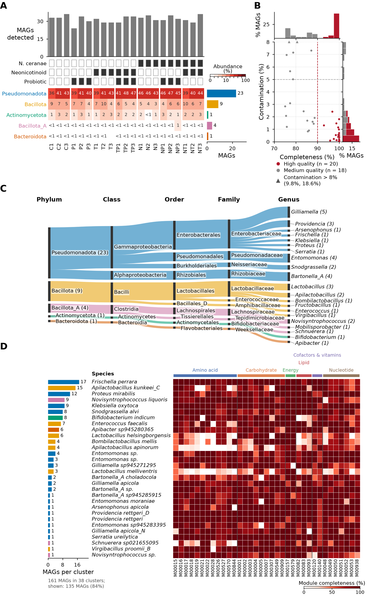

# MAGs-visualization

Plots for catalogues of metagenome-assembled genomes (MAGs): quality, taxonomy,
species-level clusters, abundance across samples and functional potential.
It reads the standard outputs of a MAG workflow (CheckM/CheckM2, GTDB-Tk, dRep,
CoverM, QUAST, Bakta, KEGG pathway completeness) and is available as a
command-line tool, a Python package and [Galaxy tools](https://toolshed.g2.bx.psu.edu/view/iuc/mags_visualization).



*`mags-visualization overview-figure` on the bundled bee gut microbiome test data.*

## Contents

- [Installation](#installation)
- [Quick start](#quick-start)
- [Plots](#plots) – what each subcommand draws ([gallery with all plots](docs/plots.md))
- [Input files](#input-files)
- [Options](#options) – full reference in [docs/cli.md](docs/cli.md)
- [Development](#development)

## Installation

From [Bioconda](https://bioconda.github.io/recipes/mags-visualization/README.html):

```bash
conda install -c conda-forge -c bioconda mags-visualization
```

From source:

```bash
git clone https://github.com/usegalaxy-eu/MAGs-visualization.git
cd MAGs-visualization
pip install .            # or: conda env create -f environment.yml && conda activate mags && pip install -e .
mags-visualization --help
```

Static Plotly exports (PNG/PDF/SVG of the Sankey diagram) need `kaleido` 0.2.1, which is installed with the
package.

## Quick start

Every plot is one subcommand. All of them write into the folder given with `-o`:

```bash
mags-visualization overview-figure \
  --gtdb test-data/gtdb.tsv --coverm test-data/coverm.tsv --checkm2 test-data/checkm2.tsv \
  --drep test-data/drep.csv --pathways test-data/kegg_pathway_completeness.tsv \
  --metadata test-data/metadata.tsv --meta_cols 7 8 9 --sample_label_col Label --sample_group_col Condition \
  --format png svg -o overview
```

The [gallery](docs/plots.md) shows the command and the result for every subcommand and mode.

## Plots

| Subcommand | Plot | Required inputs |
|---|---|---|
| `overview-figure` | Page-width multi-panel figure: abundance per sample and taxon, MAG quality, taxonomic flow, largest clusters with KEGG modules. Any subset of panels. | `--gtdb` + per panel: `--coverm` (abundance), `--checkm2`/`--checkm` (quality), `--drep` + `--pathways` (function) |
| `sample-heatmap` | Relative abundance per sample and taxon with metadata bars | `--coverm`, `--gtdb` |
| `comp-conta` | Completeness vs contamination with marginal histograms, coloured by quality, taxonomy or metadata | `--checkm`/`--checkm2` (+ `--gtdb` for `--mode tax`, `--metadata --meta_col` for `--mode meta`) |
| `drep-cluster-annot` | Largest dRep clusters with taxonomy and assembly statistics | `--drep`, `--gtdb` (+ `--checkm2 --quast --bakta` for annotations) |
| `drep-cluster-func` | Largest dRep clusters with KEGG module completeness | `--drep`, `--gtdb`, `--pathways` |
| `pathway-module-heatmap` | KEGG module completeness of all MAGs, grouped by pathway class | `--drep`, `--gtdb`, `--pathways` |
| `taxa-sankey` | Sankey diagram of the GTDB taxonomy (interactive HTML or static) | `--gtdb` |
| `all` | Runs the plots above in one go (legacy, mainly for testing) | all of the above |

### The overview figure

`overview-figure` is made for publication: it is drawn at its final size (`--width_cm`, default 17 cm,
a full page width) with font sizes in points (`--font_size`, default 8 pt), so the text is legible as
printed and no rescaling is needed. The layout is measured after drawing, so tick labels of one panel never
run into the next one. The four panels are:

- **A – abundance**: relative abundance (% of reads) of the MAGs of each taxon (`--tax_level`) per sample;
  metadata rows above the heatmap (`--meta_cols`; boolean columns become filled/empty squares, other columns
  coloured squares), MAGs detected per sample on top, MAGs per taxon on the right. Samples can be labelled
  and grouped from the metadata (`--sample_label_col`, `--sample_group_col`, `--group_order`).
- **B – quality**: completeness vs contamination with marginal histograms. High and medium quality are set
  with `--hq_completeness`, `--hq_contamination`, `--mq_completeness`, `--mq_contamination`. MAGs above
  `--max_contamination_axis` are drawn as triangles at the edge and their values listed in the legend,
  so no MAG is silently left out.
- **C – taxonomy**: flow (Sankey) diagram between two ranks (`--flow_ranks`, default phylum to genus); band
  width is the number of MAGs, colours follow `--color_rank`. Labels of small taxa are spread apart and
  connected to their node, so they never overlap.
- **D – function**: the `--top_n` largest species-level (dRep secondary) clusters with the completeness of
  the `--top_modules` KEGG modules of their representative MAG, selected by mean completeness (core
  functions) or variance (`--module_mode`).

`--color_rank` colours are shared by all panels. Use `--panels` to draw a subset, e.g. `--panels quality`
for a single plot.

#### Overview style of the single plots

`sample-heatmap`, `comp-conta` (`--mode quality`), `taxa-sankey` and `drep-cluster-func` draw the matching
overview panel instead of their original plot with `--style overview` (default: `--style classic`, unchanged):

| Subcommand | Panel | Output file |
|---|---|---|
| `sample-heatmap --style overview` | abundance | `heatmap_overview_<tax_level>.<format>` |
| `comp-conta --style overview` | quality (one per CheckM/CheckM2 report) | `comp_conta_overview_checkm[2].<format>` |
| `taxa-sankey --style overview` | taxonomy | `sankey_plot_overview.<format>` |
| `drep-cluster-func --style overview` | function (`--mode both` gives two) | `drep_cluster_functional_{core,difference}_overview_top<N>.<format>` |

They accept the same layout and panel options as `overview-figure` (listed below).

#### Changing the overview figure

| Option | Effect | Default |
|---|---|---|
| `--panels` | Panels to draw (`abundance quality taxonomy function`) | all |
| `--width_cm` | Width at print size; the height follows from the content | 17 |
| `--font_size` | Base font size in pt (dense labels use 85 %) | 8 |
| `--color_rank` | Rank whose taxa get one colour, shared by all panels | phylum |
| `--format`, `--dpi`, `--prefix` | Output formats (several at once), PNG resolution, file name | png, 300, overview_figure |
| `--tax_level`, `--max_taxa` | Rank of the abundance heatmap and number of taxa before pooling as "Other" | phylum, 10 |
| `--meta_cols`, `--meta_labels` | Metadata rows above the heatmap and their display names | – |
| `--sample_label_col`, `--sample_group_col`, `--group_order` | Sample labels, grouping and group order | sample names |
| `--hq_completeness`, `--hq_contamination` | High-quality thresholds | 90, 5 |
| `--mq_completeness`, `--mq_contamination` | Medium-quality thresholds (MIMAG: 50, 10) | 70, none |
| `--max_contamination_axis` | Upper limit of the contamination axis | 8 |
| `--flow_ranks FROM TO` | Ranks of the flow diagram | phylum genus |
| `--top_n`, `--top_modules`, `--module_mode` | Clusters and KEGG modules shown, module selection (`mean`/`variance`) | 30, 35, mean |

To make a tall figure fit a page, lower `--top_n`, stop the flow diagram at a higher rank or reduce
`--font_size`; to make it wider or narrower, change `--width_cm` (text keeps its size).

## Input files

| Option | File | Produced by |
|---|---|---|
| `--gtdb` | GTDB-Tk summary (`user_genome`, `classification`, …) | GTDB-Tk classify |
| `--checkm2` | CheckM2 quality report (`Name`, `Completeness`, `Contamination`, …) | CheckM2 predict |
| `--checkm` | CheckM lineage workflow table (`Bin Id`, `Completeness`, `Contamination`, …) | CheckM lineage_wf |
| `--drep` | dRep `Cdb.csv` (`genome`, `secondary_cluster`, …) | dRep dereplicate |
| `--coverm` | CoverM genome table with relative abundance per sample (rows: genomes + `unmapped`), or a folder of such tables | CoverM genome |
| `--pathways` | KEGG pathway completeness (`contig`, `module_accession`, `completeness`, `pathway_name`, `pathway_class`) | kegg-pathways-completeness |
| `--quast` | QUAST report (one column per MAG) | QUAST |
| `--bakta` | Bakta summary (one column per MAG) | Bakta |
| `--metadata` | Sample table, first column = sample names as used in the CoverM columns | – |

Genome names are matched across tables after normalisation (file extensions such as `.fasta`/`.fa`, paths and
case are ignored), so the tables can come from different tools without renaming. Example files of every input
are in [`test-data/`](test-data) (bee gut microbiome, 38 species-level representative MAGs). Complete use
cases with their commands are in [`use-cases/`](use-cases/README.md).

## Options

Every subcommand has its own options; `mags-visualization <subcommand> --help` lists them with their defaults
and [docs/cli.md](docs/cli.md) contains the same reference for all subcommands. Options shared by several
plots:

| Option | Meaning |
|---|---|
| `--tax_level` | GTDB rank used for grouping/colouring (`domain` … `species`) |
| `--top_n` | Number of largest dRep clusters shown |
| `--format` | Output format: `png`, `pdf`, `svg` (and `html` for `taxa-sankey`) |
| `--fig_size W H` | Figure size in cm (where supported) |
| `--meta_cols` / `--meta_col` | Metadata columns, by name or 1-based index |
| `-o/--output` | Output folder (created if missing) |

## Development

```bash
pip install -e . pytest
pytest                              # unit, plotting and CLI tests
python scripts/build_docs.py        # regenerate docs/cli.md and the gallery (docs/plots.md, docs/gallery/)
python scripts/build_docs.py --check  # fails if docs/cli.md does not match the CLI
```

CI runs the tests, checks that `docs/cli.md` is up to date and builds the gallery as an end-to-end run of
every subcommand. When adding or changing an option, regenerate the docs and, for the Galaxy tools, update the
wrappers in [galaxyproject/tools-iuc](https://github.com/galaxyproject/tools-iuc/tree/main/tools/mags_visualization).

Releases: bump `mags_visualization/version.py`, tag `v<version>` and update the
[Bioconda recipe](https://github.com/bioconda/bioconda-recipes/tree/master/recipes/mags-visualization).

## Citation

Hottmann A., Zierep P., Faack S. *MAGs-visualization*. https://github.com/usegalaxy-eu/MAGs-visualization

## License

GPL-3.0, see [LICENSE](LICENSE).
