# Plot gallery

<!-- generated by scripts/build_docs.py, do not edit by hand -->

Every plot of `mags-visualization`, made from the bundled `test-data` (bee gut microbiome, 38 species-level representative MAGs). Run the commands from the repository root; options are described in [cli.md](cli.md).

| Example | Subcommand |
|---|---|
| [Overview figure (all panels)](#overview-figure) | `overview-figure` |
| [Overview figure, single panel](#overview-figure-single-panel) | `overview-figure` |
| [Sample heatmap, overview style](#sample-heatmap-overview-style) | `sample-heatmap` |
| [Completeness vs contamination, overview style](#comp-conta-overview-style) | `comp-conta` |
| [Taxonomy flow diagram, overview style](#taxa-sankey-overview-style) | `taxa-sankey` |
| [dRep clusters with KEGG modules, overview style](#drep-cluster-func-overview-style) | `drep-cluster-func` |
| [Sample heatmap](#sample-heatmap) | `sample-heatmap` |
| [Completeness vs contamination, coloured by quality](#comp-conta-quality) | `comp-conta` |
| [Completeness vs contamination, coloured by taxonomy](#comp-conta-tax) | `comp-conta` |
| [Completeness vs contamination, coloured by metadata](#comp-conta-meta) | `comp-conta` |
| [dRep clusters with taxonomy and assembly statistics](#drep-cluster-annot) | `drep-cluster-annot` |
| [dRep clusters with KEGG module completeness](#drep-cluster-func) | `drep-cluster-func` |
| [KEGG module heatmap](#pathway-module-heatmap) | `pathway-module-heatmap` |
| [Taxonomy Sankey diagram](#taxa-sankey) | `taxa-sankey` |

<a id="overview-figure"></a>
## Overview figure (all panels)

Page-width figure combining relative abundance per sample, MAG quality, taxonomic composition and the functional profile of the largest species-level clusters. Drawn at its print size (`--width_cm`, `--font_size`), so the text is legible as printed.

```bash
mags-visualization overview-figure \
  --gtdb test-data/gtdb.tsv \
  --coverm test-data/coverm.tsv \
  --checkm2 test-data/checkm2.tsv \
  --drep test-data/drep.csv \
  --pathways test-data/kegg_pathway_completeness.tsv \
  --metadata test-data/metadata.tsv \
  --meta_cols "Infection by Nosema ceranae" "Chronic exposure to neonicotinoid" "Treatment with probiotic" \
  --meta_labels "N. ceranae" Neonicotinoid Probiotic \
  --sample_label_col Label \
  --sample_group_col Condition \
  --group_order C P T TP N NP NT \
  -o overview-figure
```

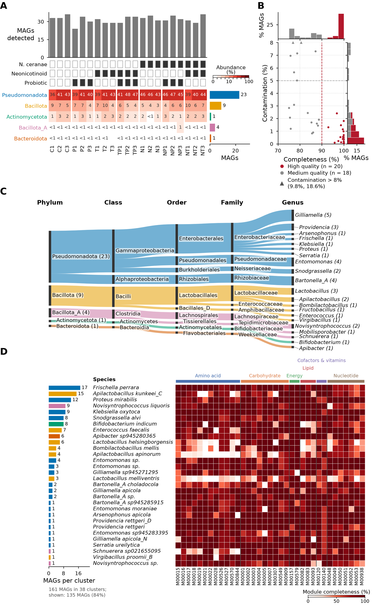

<a id="overview-figure-single-panel"></a>
## Overview figure, single panel

Any subset of panels can be drawn with `--panels`; here only the quality panel at half page width.

```bash
mags-visualization overview-figure \
  --gtdb test-data/gtdb.tsv \
  --checkm2 test-data/checkm2.tsv \
  --panels quality \
  --width_cm 8.5 \
  --font_size 7 \
  -o overview-figure-single-panel
```

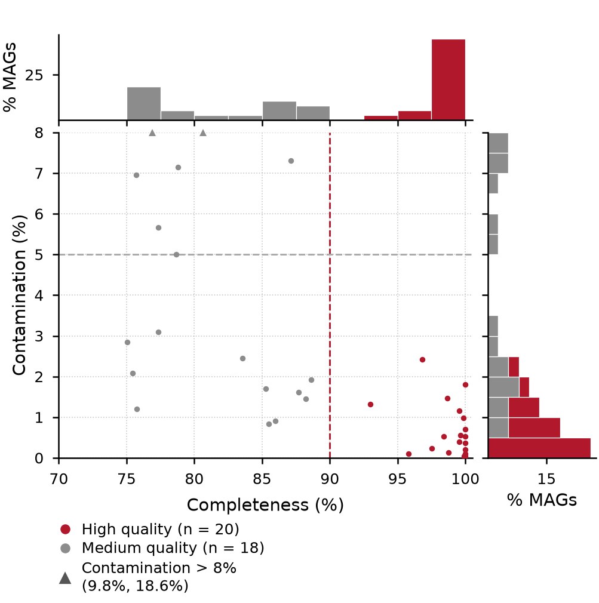

<a id="sample-heatmap-overview-style"></a>
## Sample heatmap, overview style

`--style overview` draws the abundance panel of the overview figure on its own, at print size.

```bash
mags-visualization sample-heatmap \
  --style overview \
  --coverm test-data/coverm.tsv \
  --gtdb test-data/gtdb.tsv \
  --metadata test-data/metadata.tsv \
  --meta_cols "Infection by Nosema ceranae" "Chronic exposure to neonicotinoid" "Treatment with probiotic" \
  --meta_labels "N. ceranae" Neonicotinoid Probiotic \
  --sample_label_col Label \
  --sample_group_col Condition \
  --group_order C P T TP N NP NT \
  --width_cm 12 \
  -o sample-heatmap-overview-style
```

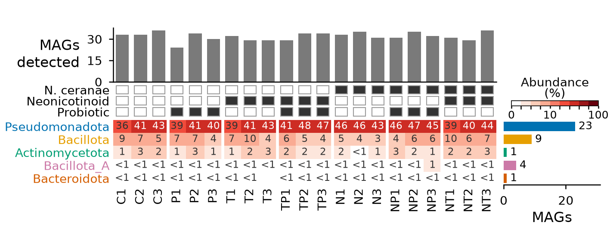

<a id="comp-conta-overview-style"></a>
## Completeness vs contamination, overview style

The quality panel on its own; quality classes are set with `--hq_*`/`--mq_*`, MAGs above `--max_contamination_axis` are marked and listed.

```bash
mags-visualization comp-conta \
  --style overview \
  --tools checkm2 \
  --checkm2 test-data/checkm2.tsv \
  --mq_contamination 10 \
  -o comp-conta-overview-style
```

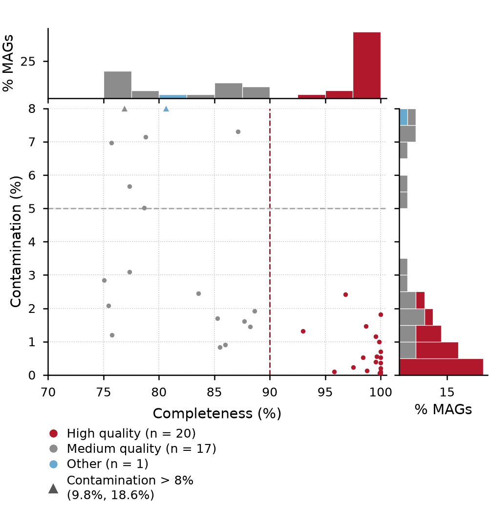

<a id="taxa-sankey-overview-style"></a>
## Taxonomy flow diagram, overview style

The taxonomy panel on its own, here from class to species and coloured by class.

```bash
mags-visualization taxa-sankey \
  --style overview \
  --gtdb test-data/gtdb.tsv \
  --flow_ranks class species \
  --color_rank class \
  --format png \
  -o taxa-sankey-overview-style
```

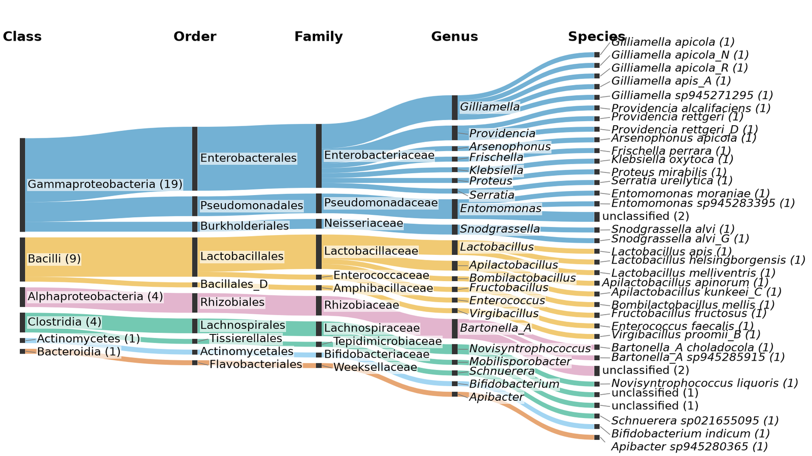

<a id="drep-cluster-func-overview-style"></a>
## dRep clusters with KEGG modules, overview style

The function panel on its own, with the 20 largest clusters.

```bash
mags-visualization drep-cluster-func \
  --style overview \
  --drep test-data/drep.csv \
  --gtdb test-data/gtdb.tsv \
  --pathways test-data/kegg_pathway_completeness.tsv \
  --top_n 20 \
  -o drep-cluster-func-overview-style
```

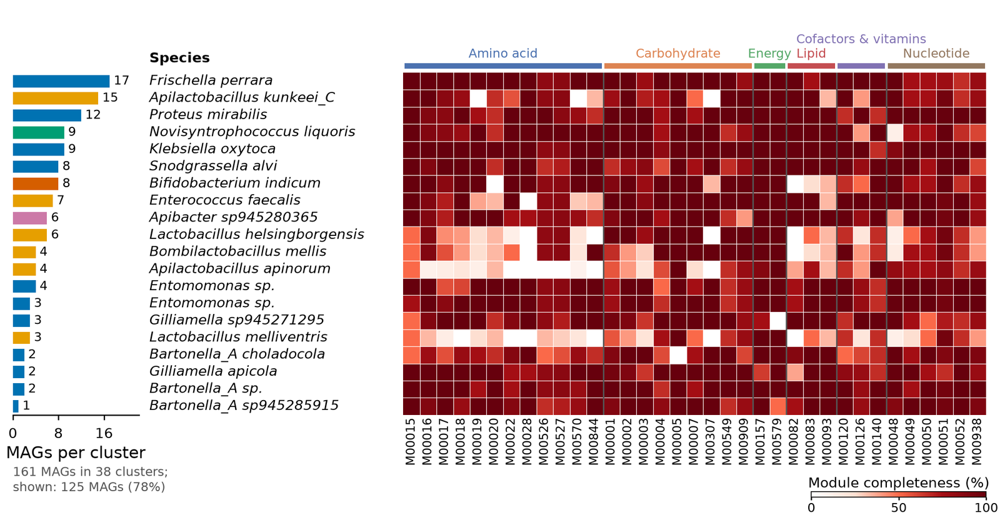

<a id="sample-heatmap"></a>
## Sample heatmap

Relative abundance of each phylum per sample, with metadata bars, MAGs per taxon (top) and MAGs per sample (right).

```bash
mags-visualization sample-heatmap \
  --coverm test-data/coverm.tsv \
  --gtdb test-data/gtdb.tsv \
  --metadata test-data/metadata.tsv \
  --meta_cols "Infection by Nosema ceranae" "Chronic exposure to neonicotinoid" "Treatment with probiotic" \
  --tax_level phylum \
  -o sample-heatmap
```

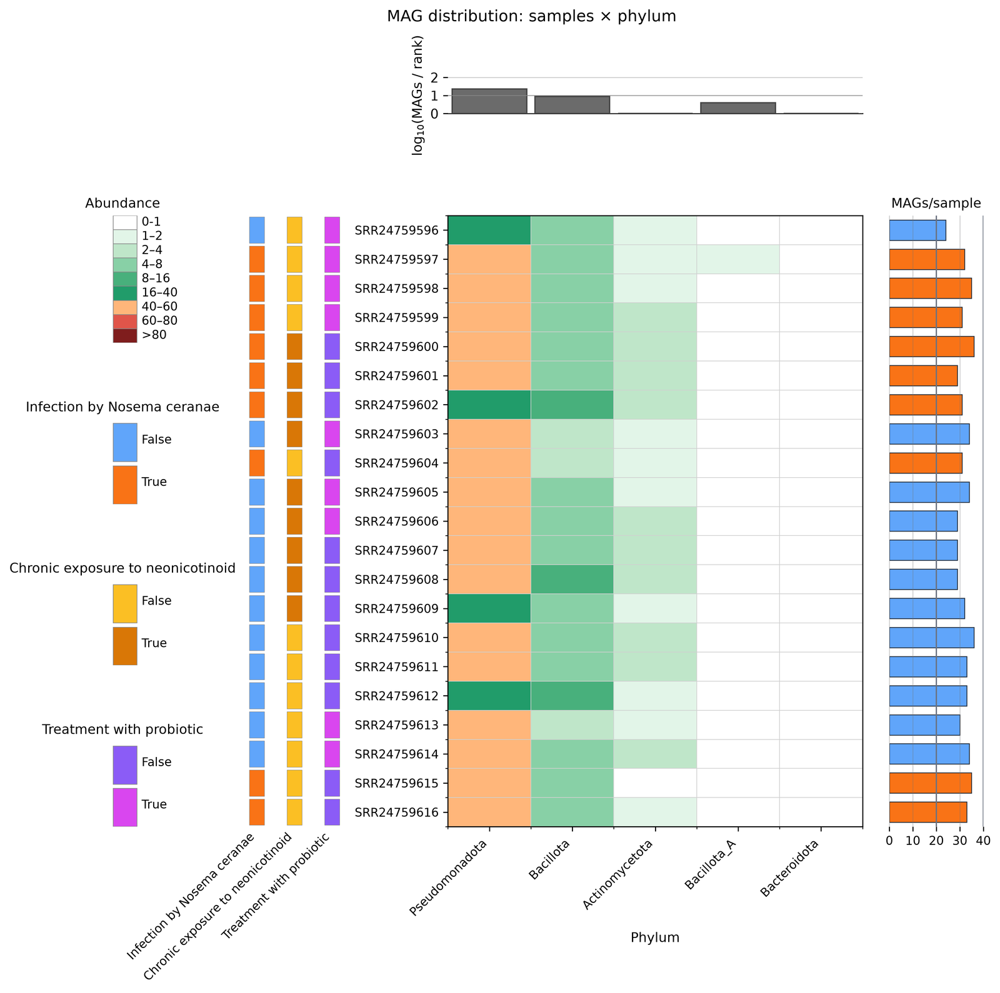

<a id="comp-conta-quality"></a>
## Completeness vs contamination, coloured by quality

CheckM and/or CheckM2 completeness against contamination with marginal histograms.

```bash
mags-visualization comp-conta \
  --tools checkm2 \
  --checkm2 test-data/checkm2.tsv \
  --mode quality \
  -o comp-conta-quality
```

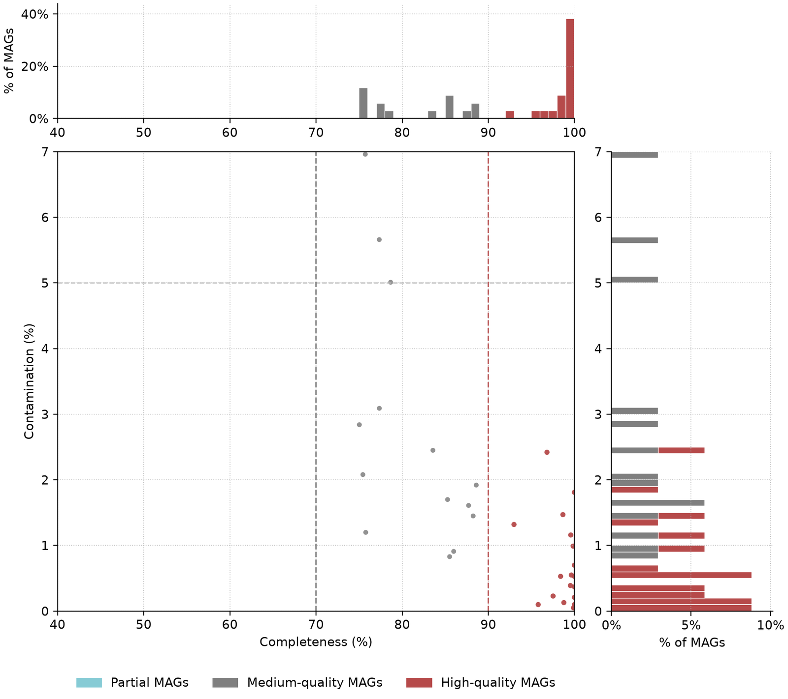

<a id="comp-conta-tax"></a>
## Completeness vs contamination, coloured by taxonomy

Points coloured by the GTDB rank given with `--tax_level`.

```bash
mags-visualization comp-conta \
  --tools checkm2 \
  --checkm2 test-data/checkm2.tsv \
  --mode tax \
  --gtdb test-data/gtdb.tsv \
  --tax_level phylum \
  -o comp-conta-tax
```

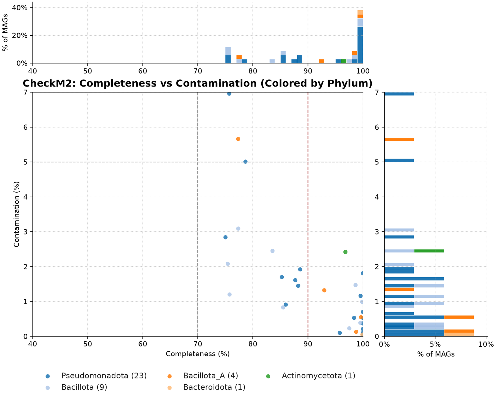

<a id="comp-conta-meta"></a>
## Completeness vs contamination, coloured by metadata

Points coloured by a sample metadata column (`--meta_col`).

```bash
mags-visualization comp-conta \
  --tools checkm2 \
  --checkm2 test-data/checkm2.tsv \
  --mode meta \
  --metadata test-data/metadata.tsv \
  --meta_col Condition \
  -o comp-conta-meta
```

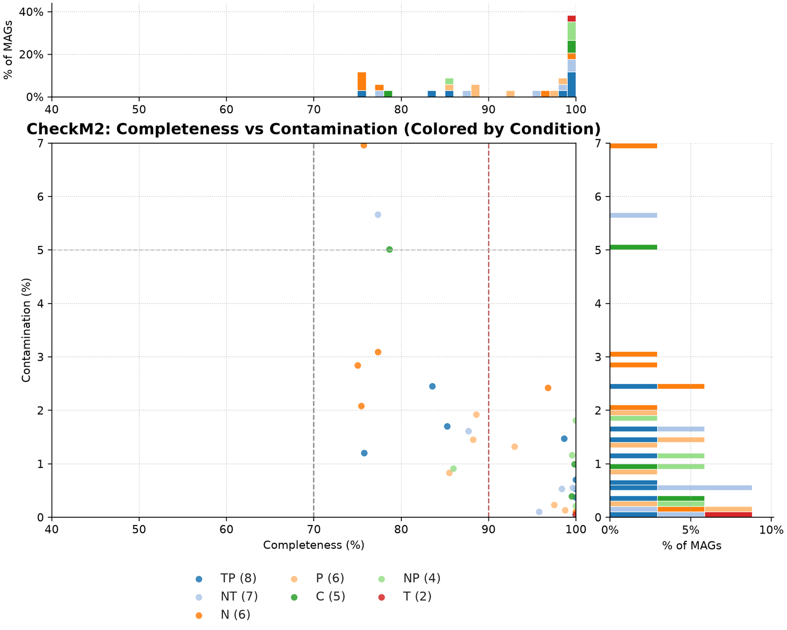

<a id="drep-cluster-annot"></a>
## dRep clusters with taxonomy and assembly statistics

The largest species-level clusters with their size, taxonomy and CheckM2/QUAST/Bakta annotation.

```bash
mags-visualization drep-cluster-annot \
  --drep test-data/drep.csv \
  --gtdb test-data/gtdb.tsv \
  --checkm2 test-data/checkm2.tsv \
  --quast test-data/quast.tsv \
  --bakta test-data/bakta.tsv \
  --top_n 30 \
  -o drep-cluster-annot
```

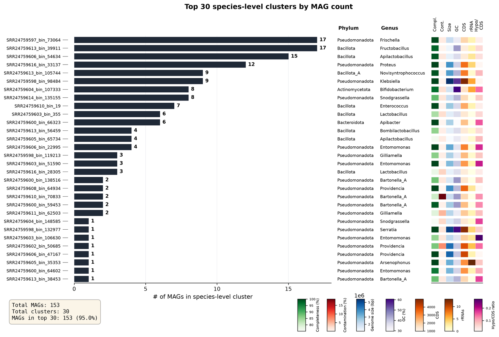

<a id="drep-cluster-func"></a>
## dRep clusters with KEGG module completeness

The largest clusters with the completeness of the KEGG modules best covered by their representatives.

```bash
mags-visualization drep-cluster-func \
  --drep test-data/drep.csv \
  --gtdb test-data/gtdb.tsv \
  --pathways test-data/kegg_pathway_completeness.tsv \
  --top_n 30 \
  -o drep-cluster-func
```

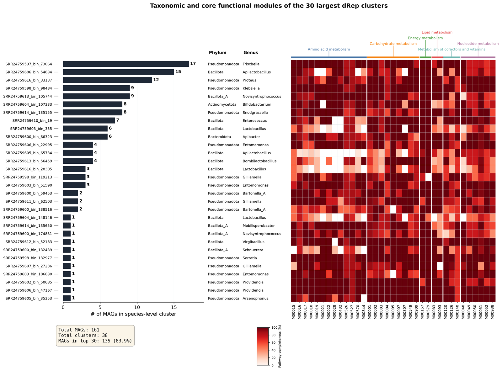

<a id="pathway-module-heatmap"></a>
## KEGG module heatmap

KEGG module completeness of all MAGs, grouped by pathway class.

```bash
mags-visualization pathway-module-heatmap \
  --drep test-data/drep.csv \
  --gtdb test-data/gtdb.tsv \
  --pathways test-data/kegg_pathway_completeness.tsv \
  -o pathway-module-heatmap
```

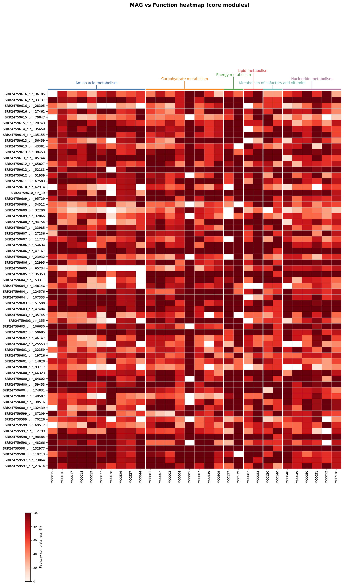

<a id="taxa-sankey"></a>
## Taxonomy Sankey diagram

Interactive (HTML) or static Sankey diagram of the GTDB taxonomy; `--order_links` minimises crossings and `--coverm` sizes the bands by abundance.

```bash
mags-visualization taxa-sankey \
  --gtdb test-data/gtdb.tsv \
  --order_links \
  --font_size 14 \
  --format png \
  -o taxa-sankey
```

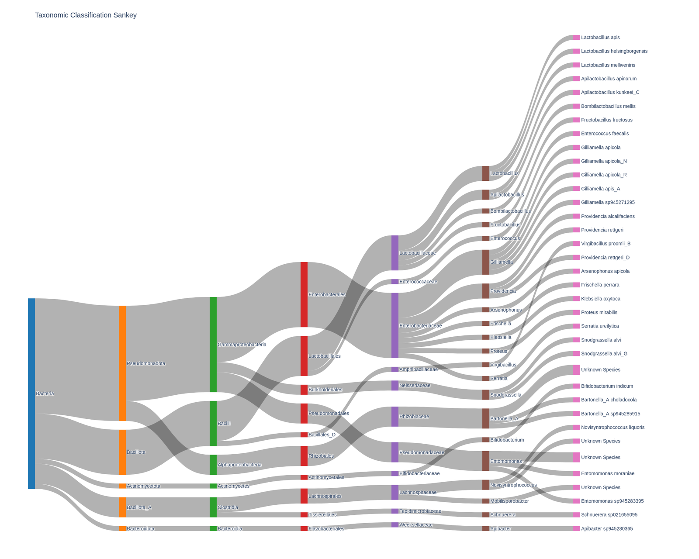

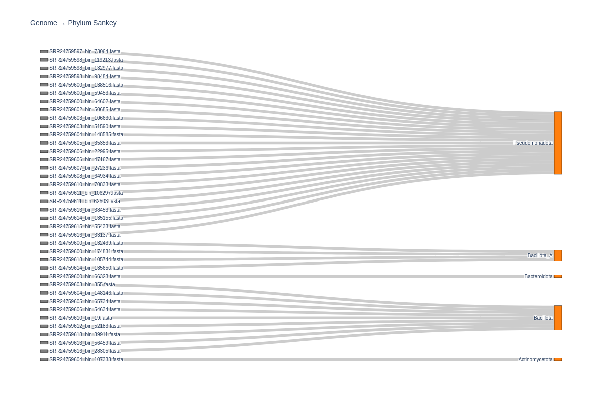
